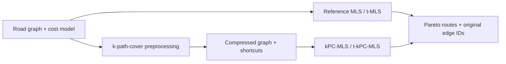

# pareto-paths

**Multicriteria routing with k-path-cover acceleration.** A C++20 library and command-line toolkit for finding Pareto-optimal routes based on arbitrary or electric-vehicle oriented constraints.

A fast route can be long. A short route can consume more energy. Instead of collapsing these tradeoffs into one weighted score, `pareto-paths` implements full Pareto optimization, which returns the nondominated alternatives: routes that cannot improve one objective without worsening another.

The underlying work was published with **Marek Cuchý and Jiří Vokřínek** in [IEEE Transactions on Intelligent Transportation Systems (2023)](https://doi.org/10.1109/TITS.2023.3282069).
- [Read the preprint](https://arxiv.org/abs/2201.12684)
- [Algorithms](docs/algorithms.md)
- [Data formats](docs/data.md)

## Quick demo

Requires CMake 3.20+ and a C++20 compiler. The library and executable have no third-party dependencies. Python 3.9+ enables the CLI integration tests; matplotlib is only needed to regenerate figures.

```sh
cmake -S . -B build -DCMAKE_BUILD_TYPE=Release
cmake --build build --parallel
ctest --test-dir build --output-on-failure
./build/pareto-paths demo
```

The bundled six-vertex example has three useful answers:

```text
0 -> 5  |  3 Pareto route(s)
  [4,16]  0 -> 1 -> 5
  [8,6]   0 -> 2 -> 5
  [12,2]  0 -> 3 -> 5
```

The first route is fastest; the last is shortest. None dominates another. The fourth candidate, `[14,18]`, is discarded.

## What is inside?

| Algorithm | Purpose |
| :--- | :--- |
| MLS | Reference multicriteria label-setting search |
| t-MLS | Dominance check speedup via dimensionality reduction |
| kPC-MLS | Operation on a compressed graph based on k-Path-Covers |
| t-kPC-MLS | Combination of compression with dimensionally reduced dominance checks |
| Point-to-point alternatives and variants | IMA, blSET, and t-kPC-IMA |
| Research tools | Seeded cost presets, reusable covers, CSV measurements, optional approximate pruning |

The t-discarding technique used by t-MLS, t-kPC-MLS, and t-kPC-IMA follows [Pulido, Mandow, and Pérez-de-la-Cruz (2015)](https://doi.org/10.1016/j.cor.2015.05.007).

Additive search supports **two or more objectives**, not just separate hardcoded two/three-criterion implementations. EV routing uses the consumption-profile model of [Baum et al. (2020)](https://doi.org/10.1007/s00453-019-00655-9), augmented with traversal time and represented using integer arithmetic. Its components are time, required initial charge, consumption, and maximum final charge, including regeneration. Abstract and EV planning share graph storage, path ownership, cover infrastructure, statistics, and the CLI.



## Use your own graph

Bavaria and Germany OpenStreetMap derivatives (residential roads removed), plus six 9th DIMACS Challenge instances, are bundled under [datasets/](datasets/README.md). Extract selected graphs with `python3 tools/datasets.py extract bayern NY`; see [Datasets and formats](docs/data.md) for the normalized columns, input commands, attribution, and dataset licenses.

```sh
# Read a small CSV and emit machine-readable routes.
./build/pareto-paths query \
  --input examples/routes.csv \
  --source 0 \
  --target 5 \
  --algorithm t-kpc-mls \
  --output json

# Retain several goals in a reusable cover; query a subset later.
./build/pareto-paths preprocess \
  --input examples/routes.csv \
  --target 2,5 \
  --k 4 \
  --triangle true \
  --output routes.cover

./build/pareto-paths query \
  --input examples/routes.csv \
  --source 0 \
  --target 5 \
  --algorithm t-kpc-mls \
  --cover routes.cover

# Battery capacity and edge energy use share the same integer unit.
./build/pareto-paths query \
  --input examples/ev.csv \
  --model ev \
  --capacity 10 \
  --target 3 \
  --algorithm t-kpc-mls
```

The C++ API returns owned results; no caller-managed label pointers or hidden global input streams:

```cpp
#include <pareto/pareto.hpp>

pareto::Graph graph(3, 2);
graph.add_edge(0, 1, {2, 8});
graph.add_edge(1, 2, {3, 4});
auto cover = pareto::build_cover(graph, {2});
pareto::SearchOptions options;
options.algorithm = pareto::Algorithm::t_kpc_mls;
auto result = pareto::search(graph, 0, {2}, options, &cover);
// result.routes.at(2)[0]: cost [5,12], vertices [0,1,2], original edges [0,1]
```

Link the CMake target `pareto::pareto` after `add_subdirectory(...)`. See `./build/pareto-paths --help` for CLI options.

## Published evaluation

The following results are from the original implementation evaluated in [Kurbanov, Cuchý, and Vokřínek (IEEE T-ITS, 2023)](https://doi.org/10.1109/TITS.2023.3282069), Tables V, VI, and VIII. The experiments used GCC 8.5.0 with `-O3` on an AMD EPYC 7543 at 2.8 GHz, with 32 GB RAM allocated.

### One-to-many search

Table V reports mean query runtimes ± standard deviations, in seconds. The Bavaria graph has **294,727 vertices and 587,782 edges**, with 1,000 goals per query; Germany has **1,521,776 vertices and 2,947,009 edges**, with 6,000 goals. Cover construction used `k = 32` and dominance pruning.

| Dataset | MLS (s) | t-MLS (s) | kPC-MLS (s) | t-kPC-MLS (s) |
| :--- | ---: | ---: | ---: | ---: |
| B-2-C | 4.24 ± 2.76 | 3.69 ± 2.08 | 0.89 ± 0.45 | **0.83 ± 0.41** |
| B-2-U | 870.30 ± 870.79 | 162.71 ± 112.96 | 220.73 ± 236.47 | **36.15 ± 26.13** |
| B-3-C | 69.66 ± 121.81 | 63.25 ± 92.99 | **9.01 ± 18.08** | 9.11 ± 16.31 |
| B-3-U | — | 8,100.95 ± 6,472.87 | 51,801.95 ± 55,113.33 | **2,577.58 ± 2,296.01** |
| G-2-C | 47.58 ± 35.81 | 34.91 ± 17.79 | 7.74 ± 4.41 | **7.04 ± 3.61** |
| G-2-U | 4,488.91 ± 2,911.09 | 1,021.18 ± 495.92 | 1,224.96 ± 833.04 | **212.26 ± 100.65** |
| G-3-C | 3,538.09 ± 3,067.47 | 2,460.66 ± 1,782.28 | 521.99 ± 467.18 | **469.48 ± 367.45** |

`B` and `G` denote Bavaria and Germany; `2`/`3` denote the number of additive criteria; `C`/`U` denote correlated/uncorrelated criteria. B-3-U has no reported MLS timing; its other timings cover only instances completed by all three modified methods. Table VI reports t-kPC-MLS speedups over MLS of **24.07× on B-2-U** and **21.15× on G-2-U**. Cover construction was evaluated separately from query execution.

### One-to-one search

Table VIII reports speedups relative to IMA on bicriteria DIMACS road graphs. The proposed one-to-one method is described as **t-kPC-IMA** in Section V.E. These experiments used `k = 16` and 100 origin-destination pairs per graph; cover construction time is excluded, while per-query bound computation is included.

| Dataset | t-kPC-IMA speedup over IMA |
| :--- | ---: |
| NY | 2.96× |
| BAY | 5.51× |
| COL | 8.67× |
| FLA | 12.95× |
| NE | 8.13× |

[Transcribed data and methodology](benchmarks/README.md) document the source tables, dataset definitions, and reporting limitations. The small synthetic benchmark presets remain available for smoke testing; they are not used here as performance evidence.

## Correctness and boundaries

- Exact additive methods are checked against exhaustive simple-path enumeration on tiny directed graphs, including parallel edges, zero-cost cycles, unreachable targets, and four-dimensional costs.
- EV profiles are checked against step-by-step charge simulation, including capacity saturation and useful regenerative loops. Positive EV traversal times are required.
- Nonnegative finite additive weights are required. Additive arithmetic uses `double`; floating-point grouping can alter near-tie costs and even frontier cardinality. EV arithmetic uses checked `int64_t` values.
- Epsilon, ellipse, and capping heuristics are **opt-in and approximate**. They may (and generally do) omit Pareto routes; outputs identify approximate runs. No approximation-error guarantee is asserted.
- Exact multicriteria search can require exponentially many labels or shortcuts. Resource budgets fail explicitly instead of returning an incomplete result labeled exact. This is research software, not a production navigation engine.

For sanitizer checks:

```sh
cmake -S . -B build-sanitize -DCMAKE_BUILD_TYPE=Debug -DPARETO_SANITIZERS=ON
cmake --build build-sanitize --parallel
ctest --test-dir build-sanitize --output-on-failure
```

## Research and attribution

Temirlan Kurbanov, Marek Cuchý, and Jiří Vokřínek. **Fast One-to-Many Multicriteria Shortest Path Search.** *IEEE Transactions on Intelligent Transportation Systems*, 24(10), 10410–10419, 2023. [DOI: 10.1109/TITS.2023.3282069](https://doi.org/10.1109/TITS.2023.3282069).

The EV model and t-discarding technique are based on the following works:

- M. Baum, J. Dibbelt, T. Pajor, J. Sauer, D. Wagner, and T. Zündorf. **Energy-Optimal Routes for Battery Electric Vehicles.** *Algorithmica*, 82, 1490–1546, 2020. [DOI: 10.1007/s00453-019-00655-9](https://doi.org/10.1007/s00453-019-00655-9).
- F.-J. Pulido, L. Mandow, and J.-L. Pérez-de-la-Cruz. **Dimensionality reduction in multiobjective shortest path search.** *Computers & Operations Research*, 64, 60–70, 2015. [DOI: 10.1016/j.cor.2015.05.007](https://doi.org/10.1016/j.cor.2015.05.007).

The cover construction builds on k-path-cover research by Funke, Nusser, and Storandt; MLS builds on Martins' multicriteria label-setting algorithm. See the paper and [algorithm notes](docs/algorithms.md) for the research lineage. This refactor is a new implementation derived from the original sources, with documented corrections; it is not claimed to be a byte-for-byte archival reproduction.

The software is licensed under the [MIT License](LICENSE). Bundled datasets retain their [separate licenses and attribution](datasets/README.md); publisher PDFs are excluded. See [release notes](docs/release.md).
