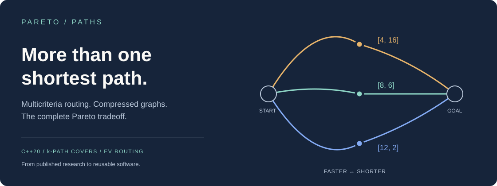
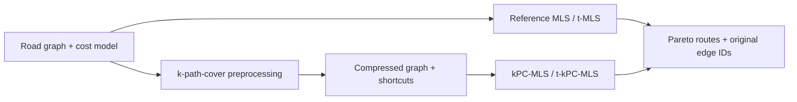
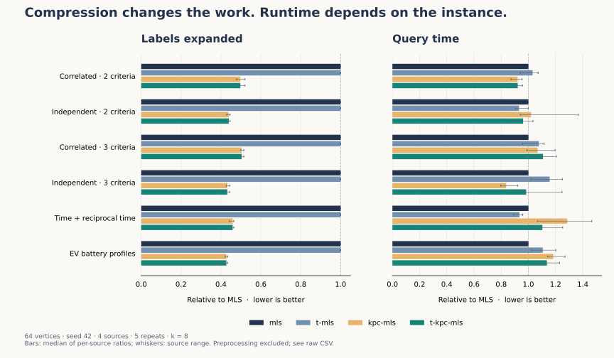

<p align="center">
  
</p>

# pareto-paths

**Multicriteria routing with k-path-cover acceleration.** A C++20 library and command-line toolkit for finding Pareto-optimal routes, comparing search strategies, and exploring electric-vehicle battery constraints.

A fast route can be long. A short route can consume more energy. Instead of collapsing these tradeoffs into one weighted score, `pareto-paths` returns the nondominated alternatives: routes that cannot improve one objective without worsening another.

This project modernizes my original research implementation, which grew into five experimental codebases. The underlying work was published with **Marek Cuchý and Jiří Vokřínek** in [IEEE Transactions on Intelligent Transportation Systems (2023)](https://doi.org/10.1109/TITS.2023.3282069). [Read the preprint](https://arxiv.org/abs/2201.12684) · [Algorithms](docs/algorithms.md) · [Data formats](docs/data.md) · [Modernization notes](docs/modernization.md) · [Verification](docs/verification.md)

## Run it in a minute

Requires CMake 3.20+ and a C++20 compiler. The library and executable have no third-party dependencies. Python 3.9+ enables the CLI integration tests; matplotlib is only needed to regenerate figures.

```sh
cmake -S . -B build -DCMAKE_BUILD_TYPE=Release
cmake --build build --parallel
ctest --test-dir build --output-on-failure
./build/pareto-paths demo
```

The bundled six-vertex example has three useful answers:

```text
0 -> 5  |  3 Pareto route(s)
  [4,16]  0 -> 1 -> 5
  [8,6]   0 -> 2 -> 5
  [12,2]  0 -> 3 -> 5
```

The first route is fastest; the last is shortest. None dominates another. The fourth candidate, `[14,18]`, is discarded.

## What is inside?

| Capability | Purpose |
| :--- | :--- |
| MLS | Reference multicriteria label-setting search |
| t-MLS | Reduce dominance checks by dropping the first cost dimension when ordering permits |
| kPC-MLS | Search a compressed graph of retained vertices and nondominated shortcuts |
| t-kPC-MLS | Combine compression with dimensionally reduced dominance checks |
| Point-to-point variants | IMA, blSET, and two bounded cover-search strategies |
| EV model | Time, required initial charge, consumption, and maximum final charge, including regeneration |
| Research tools | Seeded cost presets, reusable covers, CSV measurements, optional approximate pruning |

Additive search supports **two or more objectives**, not just separate hardcoded two/three-criterion implementations. EV routing uses its own integer battery algebra. Both share graph storage, path ownership, cover infrastructure, statistics, and the CLI.



## Use your own graph

```sh
# Read a small CSV and emit machine-readable routes.
./build/pareto-paths query --input examples/routes.csv \
  --source 0 --target 5 --algorithm t-kpc-mls --output json

# Retain several goals in a reusable cover; query a subset later.
./build/pareto-paths preprocess --input examples/routes.csv \
  --target 2,5 --k 4 --triangle true --output routes.cover
./build/pareto-paths query --input examples/routes.csv \
  --source 0 --target 5 --algorithm t-kpc-mls --cover routes.cover

# Battery capacity and edge energy use share the same integer unit.
./build/pareto-paths query --input examples/ev.csv \
  --model ev --capacity 10 --target 3 --algorithm t-kpc-mls

# Compare all point-to-point methods on a seeded graph.
./build/pareto-paths benchmark --preset independent2 --nodes-count 64 \
  --algorithms mls,ima,blset,kpc-ima,kpc-ima-straight --k 8 > comparison.csv
```

The C++ API returns owned results; no caller-managed label pointers or hidden global input streams:

```cpp
#include <pareto/pareto.hpp>

pareto::Graph graph(3, 2);
graph.add_edge(0, 1, {2, 8});
graph.add_edge(1, 2, {3, 4});
auto cover = pareto::build_cover(graph, {2});
pareto::SearchOptions options;
options.algorithm = pareto::Algorithm::t_kpc_mls;
auto result = pareto::search(graph, 0, {2}, options, &cover);
// result.routes.at(2)[0]: cost [5,12], vertices [0,1,2], original edges [0,1]
```

Link the CMake target `pareto::pareto` after `add_subdirectory(...)`. See `./build/pareto-paths --help` for CLI options.

## Measure, do not assume



These are **new measurements of this implementation**, not reproductions of the paper's country-scale experiments. Small synthetic graphs make examples easy to reproduce, but compression and bookkeeping can cost more than they save. Runtime depends on the graph, cost correlation, targets, and hardware. The EV examples are forward graphs; road graphs with regenerative cycles retain more cover vertices.

The figure shows median per-source ratios over four sources and five repeats on 64-vertex forward graphs. Whiskers show the range across sources. Preprocessing is reused and reported separately. Every benchmark query checks its Pareto costs against MLS. [Raw results](benchmarks/results.csv) · [Environment and commands](benchmarks/environment.json)

```sh
# Basic measurements need no Python packages.
./build/pareto-paths benchmark --preset independent3 --seed 42 --k 8 > timings.csv

# Re-run the complete figure experiment.
python3 -m venv .venv
.venv/bin/pip install -r tools/requirements.txt
.venv/bin/python tools/benchmark.py --binary build/pareto-paths
```

## Correctness and boundaries

- Exact additive methods are checked against exhaustive simple-path enumeration on tiny directed graphs, including parallel edges, zero-cost cycles, unreachable targets, and four-dimensional costs.
- EV profiles are checked against step-by-step charge simulation, including capacity saturation and useful regenerative loops. Positive EV traversal times are required.
- Nonnegative finite additive weights are required. Additive arithmetic uses `double`; floating-point grouping can alter near-tie costs and even frontier cardinality. EV arithmetic uses checked `int64_t` values.
- Epsilon, ellipse, and capping heuristics are **opt-in and approximate**. They may omit Pareto routes; outputs identify approximate runs. No approximation-error guarantee is asserted.
- Exact multicriteria search can require exponentially many labels or shortcuts. Resource budgets fail explicitly instead of returning an incomplete result labeled exact. This is research software, not a production navigation engine.

For sanitizer checks:

```sh
cmake -S . -B build-sanitize -DCMAKE_BUILD_TYPE=Debug -DPARETO_SANITIZERS=ON
cmake --build build-sanitize --parallel
ctest --test-dir build-sanitize --output-on-failure
```

## Research and attribution

Temirlan Kurbanov, Marek Cuchý, and Jiří Vokřínek. **Fast One-to-Many Multicriteria Shortest Path Search.** *IEEE Transactions on Intelligent Transportation Systems*, 24(10), 10410–10419, 2023. [DOI: 10.1109/TITS.2023.3282069](https://doi.org/10.1109/TITS.2023.3282069).

The cover construction builds on k-path-cover research by Funke, Nusser, and Storandt; MLS builds on Martins' multicriteria label-setting algorithm. See the paper and [algorithm notes](docs/algorithms.md) for the research lineage. This refactor is a new implementation derived from the original sources, with documented corrections; it is not claimed to be a byte-for-byte archival reproduction.

Licensed under the [MIT License](LICENSE). Publisher PDFs and external datasets are excluded and retain their own licensing terms. See [release notes](docs/release.md).
